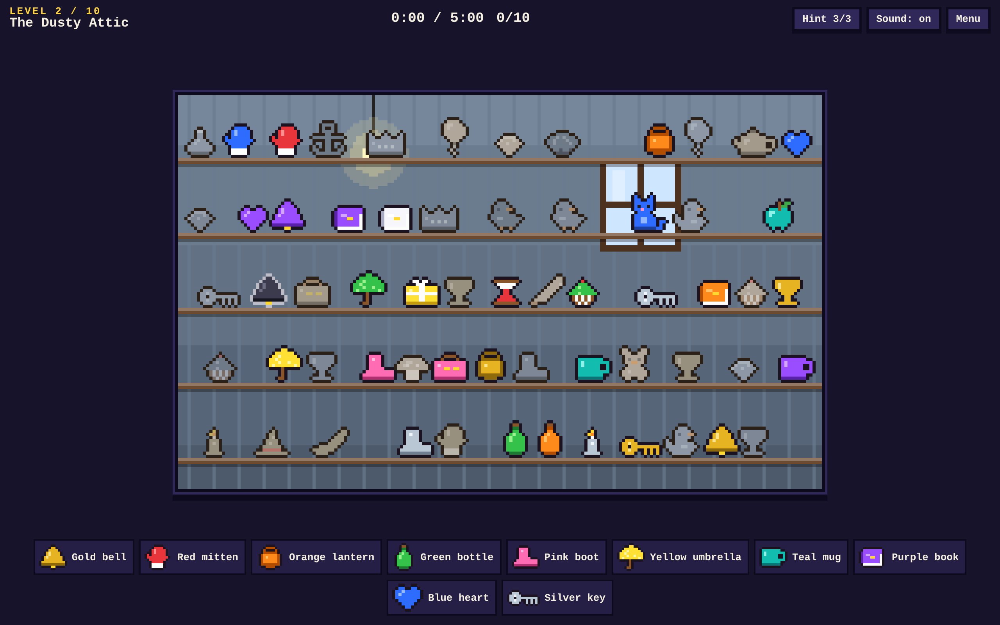

# Hidden Objects

A procedurally generated, pixel-art hidden-object game that runs entirely in the browser.
No build step, no dependencies: open `index.html` (or serve the folder with any static server).



```
python3 -m http.server 8000   # then visit http://localhost:8000
```

## How to play
Find every object in the list at the bottom of the screen by clicking it in the scene.
Larger scenes scroll: drag with the mouse (or swipe) to look around. `H` uses a hint, `Esc` opens the menu.
Lookalike decoys (same shape in another colour, or the same colour in another shape) are never on your list.

## What is stored in the browser
Only the current level number, under the `localStorage` key `hiddenObjectsLevel`.
Nothing else (no times, scores or settings) is saved.

## How it works
| File | Role |
| --- | --- |
| `js/sprites.js` | ~46 ASCII pixel-art grids, recoloured per use, auto-outlined; muted/saturated palettes |
| `js/themes.js` | Ten scene themes and the procedural background painter (gradients, patterns, scenery, ledges) |
| `js/levels.js` | Level data: targets, counts, hint rules, density/occlusion knobs (mirrors the plans in `levels/`) |
| `js/generator.js` | Seeded layout: places targets, red herrings, then muted clutter, enforcing the readability rules |
| `js/game.js` | UI, input, render loop, hints, moving/gated targets, progression |
| `js/audio.js` | WebAudio blips |

A level's seed is its number, so each level always generates the same scene.

### Readability guarantees (checked by the generator)
- Targets are saturated and outlined; background clutter uses a muted palette.
- Targets are spread evenly over each screen-width of the scene.
- Anything may cover at most `occ` of a target's box (0% in level 1 up to 30% in the finale).
- A decoy is never the same shape *and* hue family as any target in the level.
- Dark scenes give saturated items a light outline so nothing hides in shadow.

## Design docs
`levels/*.txt` hold the original level plans. The game follows their themes, object counts, hint
recharge rules, moving targets (levels 7 and 10) and the gated final book (level 10). Some
specifics were adapted to the available sprite set (e.g. a teapot stands in for the watering can),
and extras like parallax and a colourblind mode are not implemented yet.
